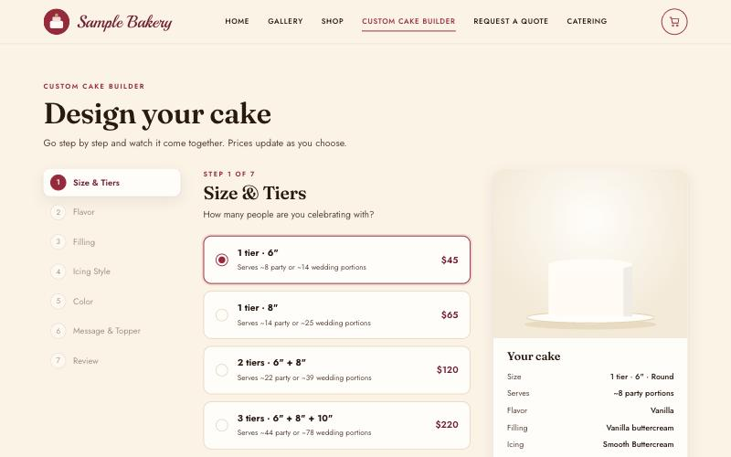

# Bakery Order Management

**Taking a one-person cake business from DM orders to a self-serve ordering system with a two-factor admin portal.**

> **Draft · private repository.** Sections marked `TODO` are still being written. Nothing here is public until our partner approves it in writing. The partner is described only as *a small custom-cake bakery* (wording pending partner approval).

## 60-second summary

<!-- TODO (team): replace with the intro figure from Task List #3 once it is cleaned up for a public reader. -->

A small custom-cake bakery was taking every order through direct messages: customers asked for prices, went back and forth about flavors and dates, and the owner tracked everything by hand. Orders got lost, and customers asked for dates the owner was already booked.

We built a website where customers design a cake step by step and see the price as they choose, pick a pickup date from a calendar that only shows open days, and send the order in one place. The owner reviews everything in a private, two-factor admin portal and answers each request with one click, which emails the customer.

<!-- TODO (team): add the headline result here once we have it, e.g. "X% fewer back-and-forth messages per order". -->


*The Custom Cake Builder, running on synthetic sample data.*

## The problem and why it matters

<!-- TODO (owner: _teammate_) · CAP domains I and II: business problem framing and analytics problem framing. ~150–250 words. -->

## The data

<!-- TODO (owner: _teammate_) · CAP domain III. Describe the data in general terms only, e.g. "In collaboration with a small custom-cake bakery, we analyzed…". No raw data, schemas copied from partner systems, or identifying numbers. -->

## Approach and methodology

<!-- TODO (team) · CAP domains IV and V. Add the methodology workflow sketch from Task List #3 here. -->

### The ordering system (website front end and back end)

*Owner: Santiago Velasquez · Reviewer: _teammate_*


The website replaces a long chat thread with one guided form. A customer can order a ready-made cake from the shop, design one in a seven-step builder (size, flavor, filling, icing, color, message, review), or ask for a quote on a fully custom design. Prices update with every choice, so there is no "how much would that be?" message.

Picking a date was the biggest source of back-and-forth, so the calendar only lets customers choose days that are far enough ahead and that the owner has not blocked. The owner blocks days off in the portal and the public calendar updates right away.

When an order is sent, a database function checks it again before saving it: the prices must match the current menu, every item must still be offered, and the date must still be open. Changing a price in the browser doesn't work, and a day the owner blocked can't be booked.

The owner works from a private admin portal that requires a password and an authenticator app. Orders show up on a calendar. Each one can be accepted, declined with a suggested new date, or answered with questions, and the reply is emailed to the customer automatically.

## Results and recommendations

<!-- TODO (team) · CAP domains V and VI. Quantify impact wherever we can, using only approved figures. -->

## How to reproduce

**Time:** about 2 minutes for the demo, about 20 minutes with your own Supabase project.

### 1. Run the website on synthetic data (no accounts needed)

```bash
git clone <this-repo-url>
cd bakery-order-management
npm start            # or: python3 -m http.server 8080 --directory src/web
```

Open http://localhost:8080. With the placeholder values in `src/web/js/config.js`, the site runs in **demo mode**: the catalog comes from `src/web/js/data.js`, the calendar blocks Mondays plus a few sample days, and orders are saved in your browser's local storage (open the console and run `DemoBackend.requests()` to see them).

### 2. Connect a real backend (optional)

1. Create a free project at [supabase.com](https://supabase.com) and install the CLI (`npm install`).
2. Apply the schema in order: `npx supabase link --project-ref <ref>` then `npm run db:push` (runs `supabase/migrations/0001…0006`).
3. Put your project URL and publishable key in `src/web/js/config.js`.
4. Create the owner account in Supabase Auth, then add its user id to `public.admins` in the SQL editor. The portal asks the owner to set up an authenticator app on first login.
5. Optional email: set the secrets listed in `.env.example`, then `npm run fn:deploy`.
6. The "too soon" check uses the bakery's local time zone, set to `America/New_York` in `0001_init.sql` and `0003_catalog.sql`. Change it to yours.
7. Rename `src/web/admin.html` to a hard-to-guess file name before deploying.

<!-- TODO (team): add the run order for notebooks and analysis scripts as they land. -->

## Repository structure

| Path | What it is |
|---|---|
| `src/web/` | Static website (HTML, CSS, JavaScript; no build step) |
| `src/web/admin.html` | Owner portal: calendar, orders, quotes, menu and price editor |
| `src/web/js/demo-backend.js` | Local stand-in for Supabase used in demo mode |
| `supabase/migrations/` | Database schema, row-level security and order-checking functions |
| `supabase/functions/respond/` | Edge function that saves the owner's reply and emails the customer |
| `data/` | Not committed. Only `data/synthetic/` is tracked |
| `notebooks/` | Analysis notebooks (outputs cleared before commit) · TODO |
| `reports/figures/` | Figures produced by the analysis · TODO |
| `docs/figures/` | Figures used in this README |

## What comes next

<!-- TODO (team) · CAP domains VI and VII: deployment, maintenance, limitations. -->

- Online deposit payments (today the deposit is arranged after the owner confirms).
- A demo mode for the admin portal, so reviewers can try it without a Supabase project.

## Team

| Name | Role | Owns |
|---|---|---|
| Santiago Velasquez | Website front end and back end | Ordering system section, `src/web/`, `supabase/` |
| _TODO_ | | |
| _TODO_ | | |

Built with HTML, CSS, vanilla JavaScript, [Supabase](https://supabase.com) (Postgres, Auth with TOTP, Storage, Edge Functions) and Vercel for hosting.

**Acknowledgment:** TODO, only in the wording our partner approves.

**AI use:** An AI coding assistant helped write parts of the website code and this README draft. Every change was reviewed and tested by the team. Identifying details were removed before anything was committed here, and the repository contains only synthetic data.
