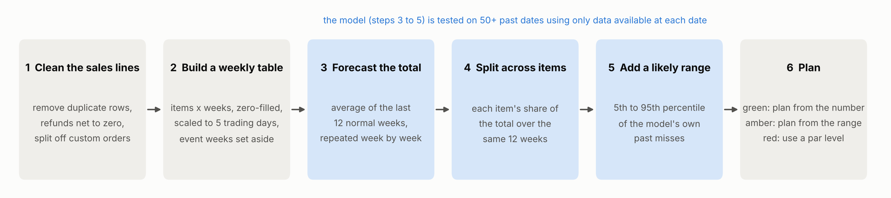
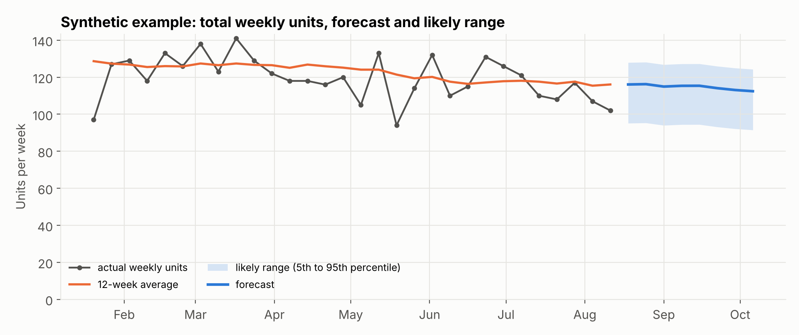

# Bakery Demand Forecasting

**Weekly, item-level sales forecasts with an honest margin of error, built for a small bakery cafe that plans production by hand.**

> **Status: first draft, private.** Sections marked **[placeholder]** are still being written. Nothing in this repository is partner data: all figures are drawn from a synthetic sample dataset, and results from the real data will be added only after our partner approves them.

<!-- Partner descriptor below ("a small bakery cafe") is a placeholder until the partner approves wording in writing. -->

## In 60 seconds

A small bakery cafe decides every week how much of each item to bake and how many supplies to order. Today that decision is based on memory and on the same week last year. We built a forecast that, each week, gives:

- **a number for each best-selling item** for the coming weeks,
- **a likely range** around that number, learned from how far past forecasts were off, and
- **a simple rating** (green, amber, red) that says whether to plan from the number, from the range, or with a fixed stock level.

The method is deliberately simple so the owner can understand and trust it: an average of recent weeks, split across items by their usual share. We tested it the way it would have been used, on more than 50 past weeks, each time using only the data available on that date.



## The problem

**[placeholder: owner TBD]** Why weekly production planning is hard for a small food business (perishable stock, wasted product on slow weeks, lost sales when items run out), and what better planning is worth. Intro figure from Task List #3 goes here.

## The data

**[placeholder: owner TBD]** In collaboration with a small bakery cafe, we used point-of-sale records covering about a year and a half of daily item sales. Each record is one item sold, with a date, a product category, a quantity and an amount. We do not publish the data or describe it in more detail. A synthetic file with the same general structure is included in `data/synthetic/` so the code can be run end to end.

## Approach: the forecasting method

<!-- Section owner: Moin Shaikh -->

The forecast works in two steps. First, it predicts **total weekly units** for the whole cafe as the average of the last 12 normal weeks. Second, it **splits that total across items** using each item's average share of sales over the same 12 weeks. For forecasts further ahead, each new week's forecast is added to the history and the average is recalculated, so one rule covers any number of weeks.

We forecast the total first because single items are noisy. An item that sells five a week can easily sell three or eight by pure chance, while the total for the whole cafe is much steadier. Forecasting a total and dividing it is known as top-down forecasting (Hyndman & Athanasopoulos, 2021, ch. 11), and it has a useful side effect: the item forecasts always add up to the total.

Before forecasting, weeks are made comparable. Every week is scaled to five trading days, weeks with fewer than three trading days are set aside, and one-off event weeks are left out so they do not inflate the average for months afterwards.

Each forecast comes with a **likely range**: the 5th to 95th percentile of the model's own past errors (Williams & Goodman, 1971). We tested the method with a walk-forward evaluation (Tashman, 2000): from each past week, forecast up to 12 weeks ahead using only earlier data, then compare with what actually sold.



## Results and recommendations

**[placeholder: pending partner approval]** Aggregate accuracy of the method against simple rules ("same as last week", "same week last year"), how often the likely range contained the actual result, and what this means for weekly planning.

## Ordering website

**[placeholder: owner TBD]** The order website and admin portal built for the bakery.

## How to reproduce

<!-- Section owner: Moin Shaikh -->

Requires Python 3.10 or newer. Everything below runs on the synthetic sample data in under a minute.

```bash
git clone <repository-url>
cd bakery-demand-forecasting
python3 -m venv .venv
source .venv/bin/activate            # Windows: .venv\Scripts\activate
pip install -r requirements.txt
nbstripout --install                 # clears notebook outputs automatically on commit

python src/make_synthetic_data.py    # 1. create data/synthetic/sample_sales.csv
python src/run_forecast.py           # 2. walk-forward test + next 4 weeks of forecasts
python src/plot_figures.py           # 3. redraw the figures in reports/figures/
```

`run_forecast.py` prints the error of the model and of two simple benchmarks, and how often actual sales fell inside the likely range. It writes `accuracy.csv`, `coverage.csv` and `forecast.csv` to `reports/output/` (not committed).

To run on real data, copy `config/settings.example.json` to `data/settings.json` and point it at your files. Everything in `data/` except `data/README.md` and `data/synthetic/` is git-ignored, so real data and its settings stay on your machine.

**[placeholder]** Notebooks for exploratory analysis and model comparison will be added to `notebooks/` with outputs cleared.

## Repository structure

```
bakery-demand-forecasting/
├── README.md
├── requirements.txt             Python packages for the forecast
├── package.json, .env.example   ordering website tooling
├── config/
│   └── settings.example.json    settings for the synthetic data (copy to data/settings.json for real data)
├── data/                        git-ignored except README.md and synthetic/
│   ├── README.md
│   └── synthetic/sample_sales.csv
├── notebooks/                   [placeholder] analysis notebooks, outputs cleared
├── reports/
│   └── figures/                 figures used in this README
└── src/
    ├── forecasting/             the forecasting package
    │   ├── config.py            settings and defaults
    │   ├── data_prep.py         cleaning, weekly calendar, item-by-week table
    │   ├── model.py             top-down recursive forecast
    │   └── evaluation.py        walk-forward test and likely ranges
    ├── make_synthetic_data.py   generates the sample dataset
    ├── run_forecast.py          runs the test and the forecast
    └── plot_figures.py          draws the README figures
```

## Limitations and next steps

**[placeholder: owner TBD]** For the forecast: sales records show what sold, not what customers wanted when an item ran out; seasonality cannot be estimated reliably until at least two full years of data exist; known events (holidays, local events, large pre-orders) should be entered as adjustments. Deployment and maintenance plan to follow.

## Tools

Python (pandas, NumPy, SciPy, statsmodels, matplotlib), Git and GitHub. **[placeholder]** website stack.

## Team

| Name | Role | LinkedIn (optional) |
|---|---|---|
| Moin Shaikh | Demand forecasting: method, evaluation, reproducibility | |
| **[placeholder]** | | |
| **[placeholder]** | | |

## Acknowledgments

This project was completed as part of an industry practicum at Purdue University in collaboration with a small bakery cafe. **[placeholder: wording to be approved by the partner]**

**[placeholder]** Use of AI tools, as required by the course AI policy.

## References

- Hyndman, R. J., & Athanasopoulos, G. (2021). *Forecasting: Principles and Practice* (3rd ed.). OTexts. https://otexts.com/fpp3/
- Tashman, L. J. (2000). Out-of-sample tests of forecasting accuracy: an analysis and review. *International Journal of Forecasting*, 16(4), 437-450.
- Williams, W. H., & Goodman, M. L. (1971). A simple method for the construction of empirical confidence limits for economic forecasts. *Journal of the American Statistical Association*, 66(336), 752-754.
