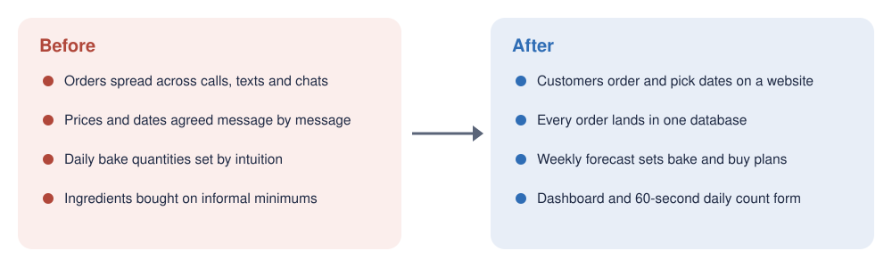
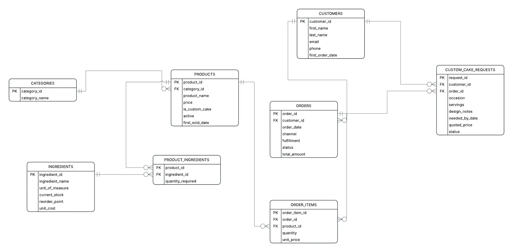
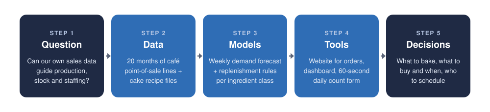
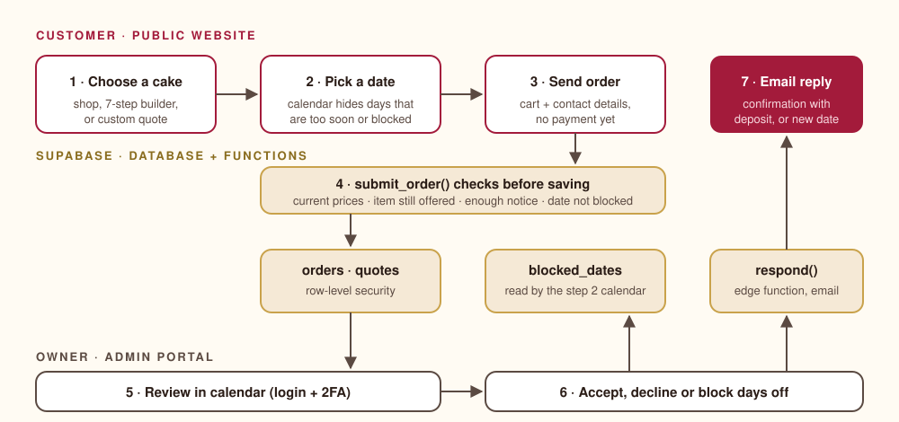
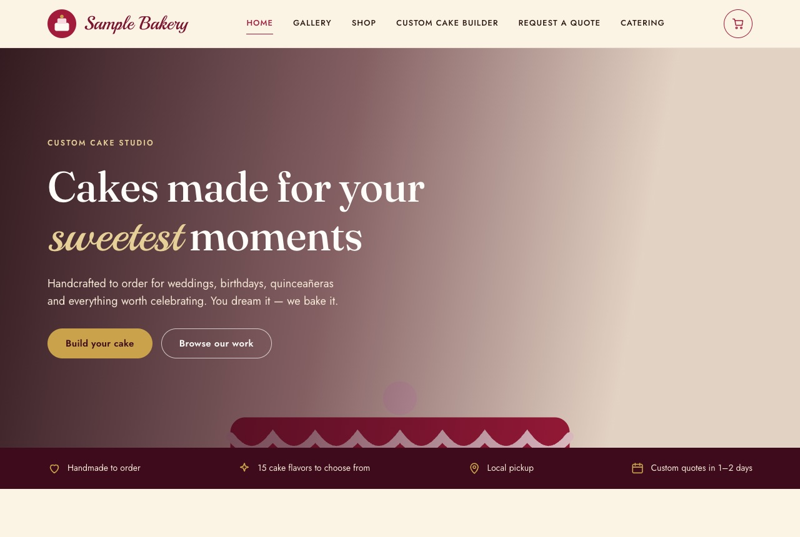
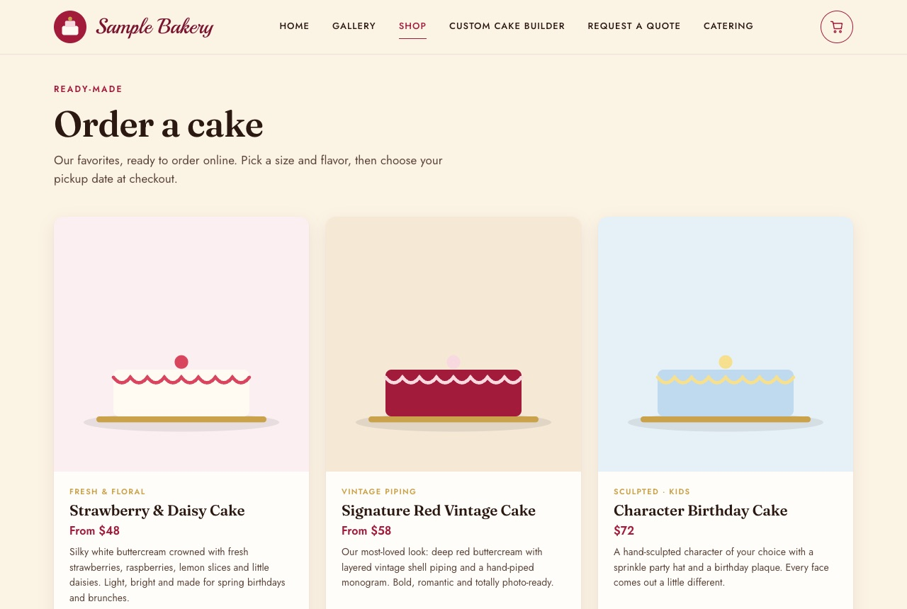
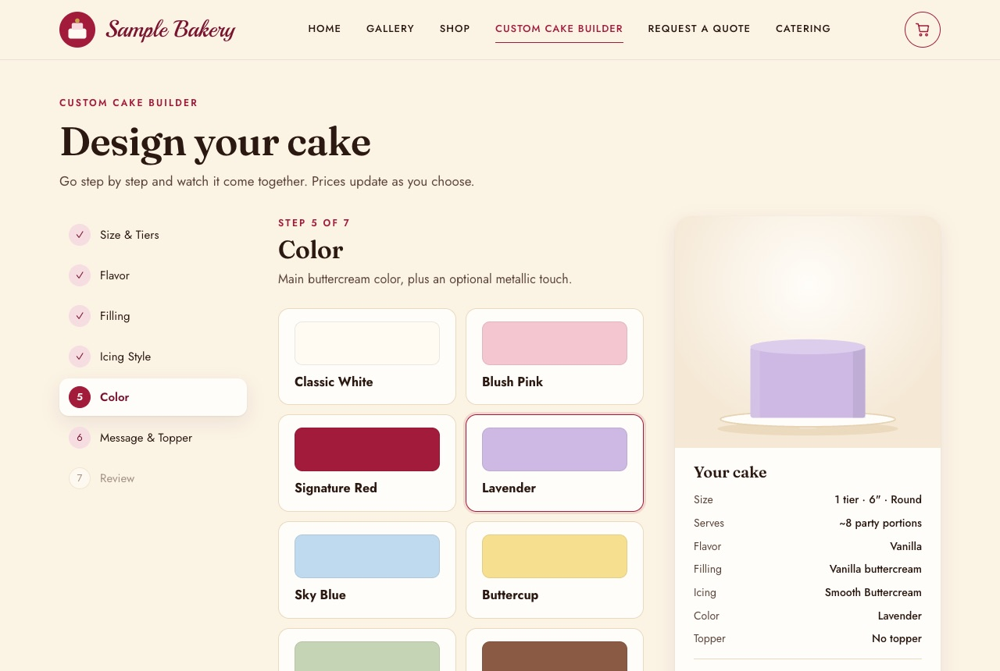
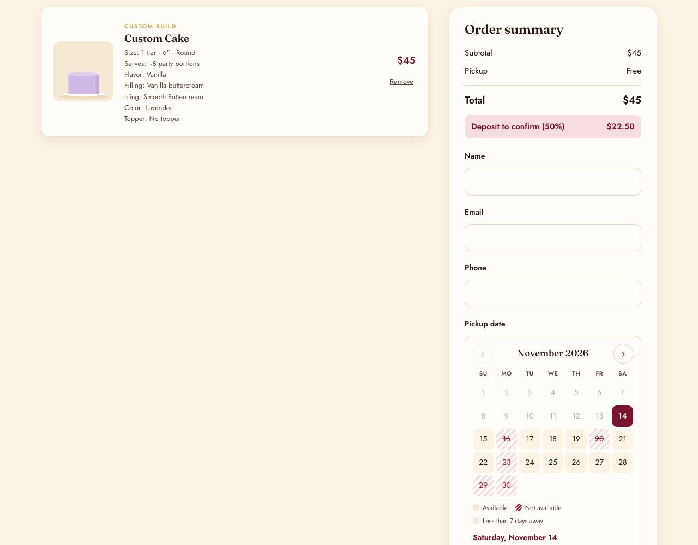
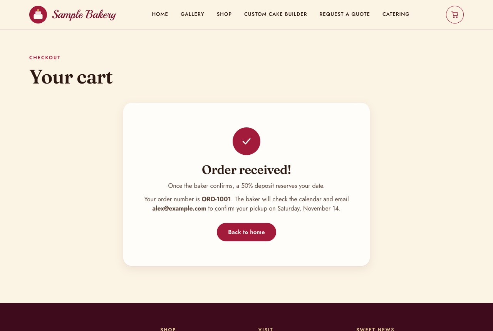
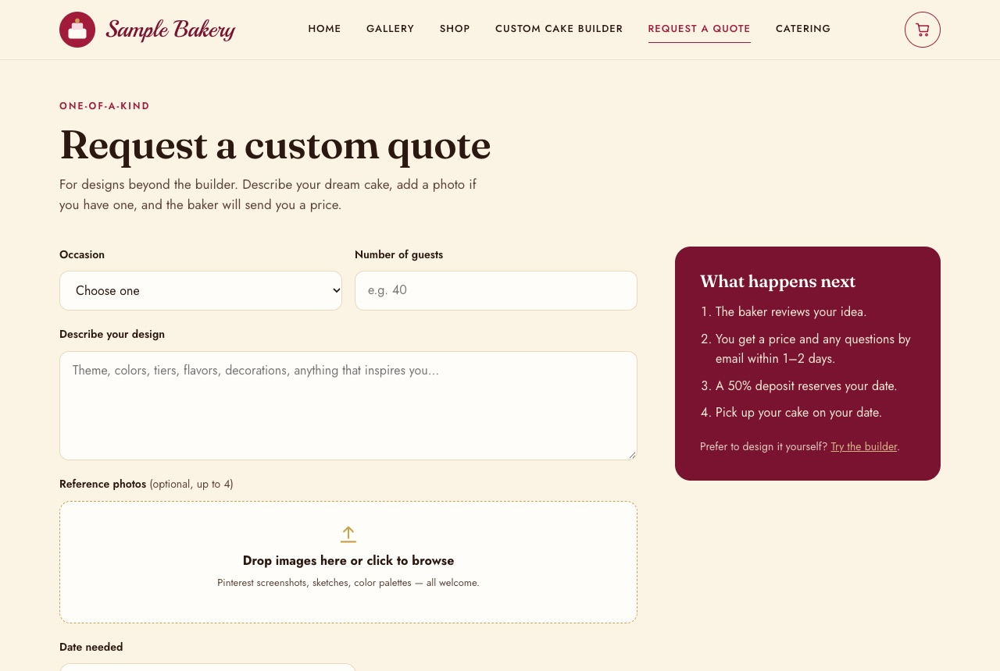

# Bakery Demand Forecasting and Inventory Analytics

**A simple weekly forecast, a few replenishment rules and an online ordering site can give a small bakery-café data-driven answers to "what do we bake, what do we buy, and when?"**

> **Project page:** open `index.html` (see *How to reproduce*). It becomes the GitHub Pages site once the repository is public.
>
> **Draft · private repository.** Nothing here is public until our partner approves it in writing. The partner is described only as *a small, owner-run bakery and café* (wording pending partner approval). No partner data is stored in this repository; figures show aggregate results only.

## 60-second summary



Small food businesses rarely have a data team. Our partner, a small bakery and café, decided how much to bake and what to buy from experience, and took custom cake orders through calls, texts and chat messages. That led to wasted product on slow days, sold-out items on busy ones, and orders that were easy to lose.

Over one semester our team of graduate students built four connected pieces:

1. **A weekly demand forecast** for the café's best-selling items, built from 20 months of point-of-sale data.
2. **An inventory framework** that turns the forecast into shopping lists, with a different rule for perishables, core supplies and packaging.
3. **A dashboard** that shows the owner sales trends and what to prepare.
4. **An online ordering website** with a two-factor admin portal, so custom cake orders arrive structured instead of in a chat thread.

**Headline result:** a deliberately simple top-down model forecasts item-level weekly demand with **36.9% error (WAPE)**, compared with **47.2%** for "sell what we sold last week". Every more complex model we tried, including XGBoost, did worse.

## 1 · The problem and why it matters

*CAP domains I and II · Owner: _TBD_*

<!-- TODO (owner): rewrite in your own words, ~150–250 words. Draft taken from the paper. -->

As the business grew, deciding daily production by gut feel became risky: overproduction means waste, underproduction means lost sales on popular items, and staffing does not follow real demand. Ingredient purchasing followed informal minimums with no records, and the owner's own decorating time, not oven capacity, limited how many custom orders could be accepted.

**Research question:** can a forecast built from the business's own point-of-sale history give the owners practical, day-to-day guidance on production, inventory and staffing?

**Business needs we framed with the owner:**
- One place to track every order and its pickup date.
- A demand forecast for the café's main items.
- Structured data for buying supplies on time.
- A clear picture of busy and slow periods for staffing.

We structured the work with a consulting-case approach (clarifying questions, structured problem framing, then recommendation, reasoning, risks and next steps) and a four-step system-design process (scope, high-level design, deep dive, wrap-up).

## 2 · The data

*CAP domain III · Owner: Sourabh Salunke (data cleaning)*

<!-- TODO (owner): review wording with the partner. Keep it general: no raw rows, column names copied from their systems, or exact dollar figures. -->

In collaboration with a small bakery-café, we worked with two proprietary sources provided by the owners. Neither is included in this repository.

| Source | What it covers | Used for |
|---|---|---|
| Café point-of-sale export | About 18,000 sales lines over 20 months, across more than 100 menu items in 15 categories | Weekly demand forecast, sales patterns |
| Recipe and ingredient file | Ingredient list and measured recipes for the custom cake flavors | Ingredient planning |
| Website orders (new) | Structured custom-cake orders, created by the site we built | Future forecasting of custom orders |

**Data preparation.** Sales lines were aggregated into an item-by-week panel and zero-filled for weeks with no sales. Three guards decide which weeks the model may learn from: volumes are scaled to the café's five-day trading week, a trailing partial week is dropped (left in, it made the forecast about 55% too low), and two one-off event weeks with unusual items are excluded.

Custom cake orders were the main data gap: they lived only in chat conversations. The ordering website (section 3.4) closes that gap going forward. The database schema behind it links customers, orders, products and ingredients:



## 3 · Approach and methodology

*CAP domains IV and V · Owners: section leads below*



### 3.1 Demand forecast

*Owner: Mohinuddin Shaikh (demand forecasting, data pipeline)*

<!-- TODO (owner): rewrite in your own words and add your polished figure, ~150–250 words. -->

We forecast weekly unit demand for the café's 18 best-selling items. Very low-volume items get a fixed par level instead, because percentage error is meaningless at one or two units a week.

The shipped model is **top-down**: estimate the store's total weekly volume as the mean of the last 12 clean weeks, then split it across items by each item's recent share of sales. Store totals are much easier to forecast than single items (about 16% error against 37%), so estimating the level once and allocating it cancels most item-level noise. The model runs recursively, so it can step through weeks that have no actuals yet.

Models were compared on **14 rolling origins** with a 4-week horizon (7,056 forecast–actual pairs each), scored by **WAPE**: total absolute error divided by total actual units. We used rolling origins instead of one holdout because the gaps between models are only a few points.

A seasonal term is built in but set to neutral for now: with about 1.5 years of data, the yearly pattern can't yet be told apart from noise (ANOVA across months, p = 0.46), and adding month factors made store-level error worse.

### 3.2 Inventory framework

*Owner: Sun Xuan (inventory, production planning)*

<!-- TODO (owner): rewrite in your own words and add your polished figure, ~150–250 words. -->

Each ingredient group gets the replenishment rule that fits its shelf life and lead time:

| Class | Examples | Rule |
|---|---|---|
| A · Perishables | Milk, dairy | **Periodic review** twice a week: order up to T = (P + L) × d + S, rounded to whole units |
| B · Core supplies | Coffee beans, tea | **Reorder point**: ROP = d × L + SS, triggered by the count of unopened bags |
| C · Packaging and drinks | Cups, lids, canned drinks | **Two-bin / red line**: a visual trigger, no data entry |

*d = average daily demand, P = review period, L = lead time, S and SS = safety stock, T = order-up-to level.*

The weekly forecast feeds a bill-of-materials conversion (for example, ounces of beans per coffee drink), which produces a supermarket run list and an online order sheet. Staff log closing counts and waste in a 60-second form, so the digital inventory stays aligned with what is really on the shelf.

### 3.3 Dashboard

*Owner: Sourabh Salunke (dashboard, reporting)*

<!-- TODO (owner): describe the dashboard and add a screenshot with synthetic or approved data, ~150–250 words. -->

### 3.4 Online ordering system

*Owner: Santiago Velasquez (website, online ordering)*



Custom cake orders were the one part of the business with no data at all, because they lived in long chat threads. The website replaces that thread with one guided form. Customers order a ready-made cake, design one in a seven-step builder (size, flavor, filling, icing, color, message, review), or ask for a quote on a fully custom design, and the price updates with every choice.

Picking a date caused the most back-and-forth, so the calendar only offers days that are far enough ahead and that the owner hasn't blocked. When an order is sent, a database function checks it again: prices must match the current menu, every item must still be offered, and the date must still be open.

The owner works from a private portal protected by a password and an authenticator app. Orders appear on a calendar and can be accepted, declined with a suggested new date, or answered with questions, and the customer is emailed automatically. Every order is stored with the fields in the schema above, which gives the forecast a new, structured data source for custom orders.

**Screenshots** (demo version: placeholder bakery name, drawn cakes, sample prices):

| | |
|---|---|
|  **Home.** Leads to the three ways to order. |  **Shop.** Ready-made cakes with starting prices. |
|  **Builder.** Seven steps; the drawing and price update with each choice. |  **Cart and calendar.** Grey = too soon, striped = blocked by the owner. |
|  **Order received.** Order number right away; nothing charged until the owner accepts. |  **Quote request.** For designs the builder can't cover. |

The admin portal isn't pictured because it needs a real login and shows real customer orders.

## 4 · Results

*CAP domains V and VI · Owner: _TBD_*


- **Simple beat complex.** Every model that tried to predict movement lost to the one that estimated the level carefully. XGBoost scored 45.7%, which we attribute to having only about 1,260 training rows for 18 series.
- **About 10 points better than the owner's natural baseline** (47.2% for carrying last week forward) and 20 points better than "same week last year". High-volume items such as coffee forecast better, at roughly 20–30% error.
- **The day of the week is the biggest unused signal.** Wednesday sells about five times as many units as Saturday, so a daily model is the next test.
- **The ordering site is live in prototype** and now records custom orders as structured data.

<!-- TODO (team): add the inventory framework's results once it is checked against real purchases and waste, and any approved impact figures (e.g., waste reduced). -->

### Recommendations for the owners

- Stock up for midweek: Wednesday is the strongest day, and the weekend is the weakest stretch.
- Build up inventory and staffing ahead of September, the peak month.
- Plan downtime or smaller orders for late December to early January, the slowest period.
- Use the twice-weekly dairy review and reorder points instead of buying on habit.

## 5 · What comes next

*CAP domains VI and VII · Owner: _TBD_*

- **Daily model** with day-of-week features.
- **Turn seasonality on** once two full years of data exist (it is one setting).
- **Validate the inventory framework** against actual purchases and waste with a fresh sales export.
- **Recipe-based ingredient planning** for confirmed custom cake orders, using the website's order data.
- **Online deposit payments** and a demo mode for the admin portal.

**Limitations:** about 1.5 years of history, five trading days a week, and custom-order history only from the website onward.

## How to reproduce

The forecasting and inventory code depend on partner data that can't be shared. A synthetic dataset with the same structure is planned so the full pipeline can run end to end.

### Project page and ordering demo (about 2 minutes)

```bash
git clone <this-repo-url>
cd bakery-demand-forecasting
python3 -m http.server 8080   # or, with Node.js installed: npm start
```

Open http://localhost:8080 for the project page (`index.html`, the web version of this README). The ordering demo is at http://localhost:8080/src/web/. With the placeholder values in `src/web/js/config.js`, the site runs in **demo mode**: the catalog comes from `src/web/js/data.js`, the calendar blocks Mondays plus a few sample days, and orders are saved in your browser (open the console and run `DemoBackend.requests()` to see them).

To connect a real backend:

1. Create a free project at [supabase.com](https://supabase.com) and install the CLI (`npm install`).
2. Apply the schema in order: `npx supabase link --project-ref <ref>` then `npm run db:push`.
3. Put your project URL and publishable key in `src/web/js/config.js`.
4. Create the owner account in Supabase Auth, then add its user id to `public.admins` in the SQL editor. The portal asks the owner to set up an authenticator app on first login.
5. Optional email: set the secrets listed in `.env.example`, then `npm run fn:deploy`.
6. The "too soon" check uses the bakery's local time zone, set to `America/New_York` in `0001_init.sql` and `0003_catalog.sql`. Change it to yours.
7. Rename `src/web/admin.html` to a hard-to-guess file name before deploying.

### Forecast and inventory

<!-- TODO (Mohinuddin, Sun Xuan): environment setup, run order (clean → aggregate → evaluate → forecast → shopping list), and run time, using data/synthetic/. -->

## Repository structure

| Path | What it is |
|---|---|
| `index.html` | Project page: the summary of this README as a web page (future GitHub Pages site) |
| `src/web/` | Ordering website and admin portal (HTML, CSS, JavaScript; no build step) |
| `src/web/js/demo-backend.js` | Local stand-in for the database, used in demo mode |
| `supabase/` | Database schema, row-level security, order checks and email function |
| `notebooks/` | Forecasting and EDA notebooks (outputs cleared before commit) · TODO |
| `data/` | Not committed. Only `data/synthetic/` is tracked |
| `reports/figures/` | Figures produced by the analysis · TODO |
| `docs/figures/` | Figures used in this README |

<!-- TODO (Mohinuddin, Sun Xuan): add src/forecast/ and src/inventory/ rows when that code lands. -->

## Literature that shaped the project

- Safieddine & Nakhoul (2021): messaging-app ordering in small firms; the same problem we saw.
- Cardoso, Leitão & Geraldes (2024): ABC classification and review policies in a bakery.
- Franco et al. (2026): lightweight forecasting for micro and small enterprises.
- Douaioui et al. (2024): review of 119 machine-learning demand forecasting studies.
- Piewthongngam, Homkhampad & Apichottanakul (2026): from sales forecasts to ingredient replenishment.
- Motamedi, Li & Down (2026): forecast-dependent ordering of perishable products.
- Xu (2020), *System Design Interview*; Cosentino (2024), *Case in Point*.

Full references are in the project paper.

## Team

| Name | Role |
|---|---|
| Mohinuddin Shaikh | Demand forecasting, data pipeline |
| Sourabh Salunke | Data cleaning, dashboard, reporting |
| Sun Xuan | Inventory, production planning |
| Santiago Velasquez | Website, online ordering and customer experience |
| Abhishek Roushan | _TODO_ |
| Prateek Jaiswal | Faculty mentor |

Built with Python (pandas, statsmodels, Prophet, XGBoost), Google Forms and Sheets, HTML/CSS/JavaScript, Supabase and Vercel. <!-- TODO (team): confirm the tool list. -->

**Acknowledgment:** We thank our industry partner for their time and trust. <!-- TODO: replace with the wording the partner approves. -->

**AI use:** An AI coding assistant helped write parts of the website code and this README draft. Every change was reviewed by the team. Identifying details were removed before anything was committed, and the repository contains only synthetic data and aggregate results.
