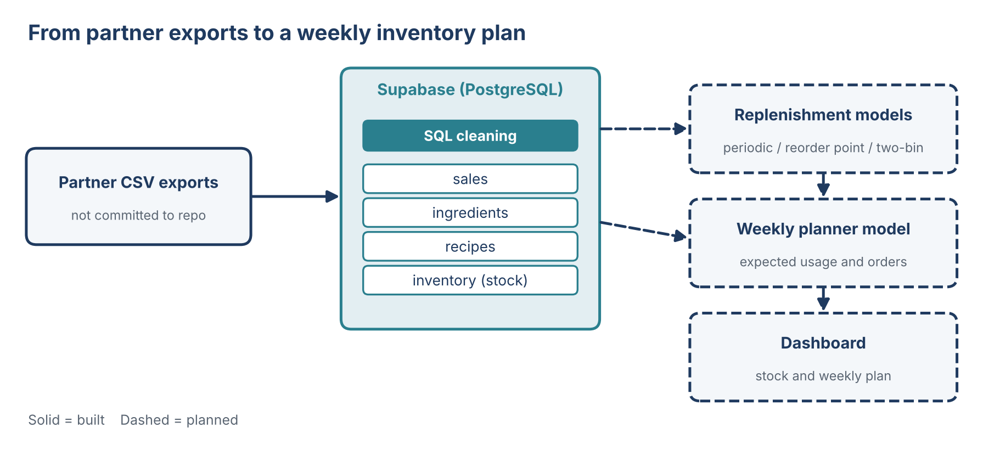
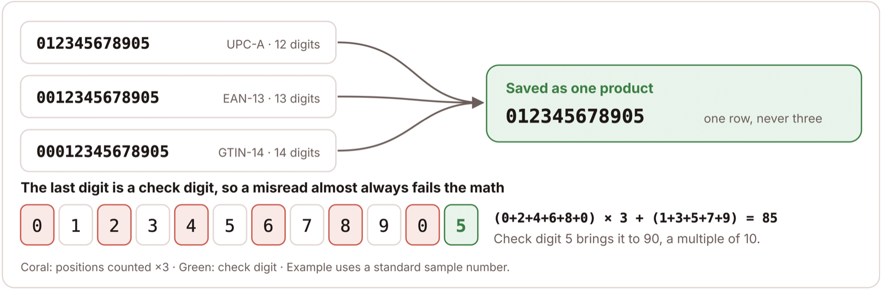
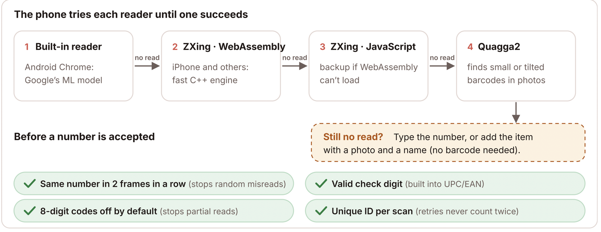
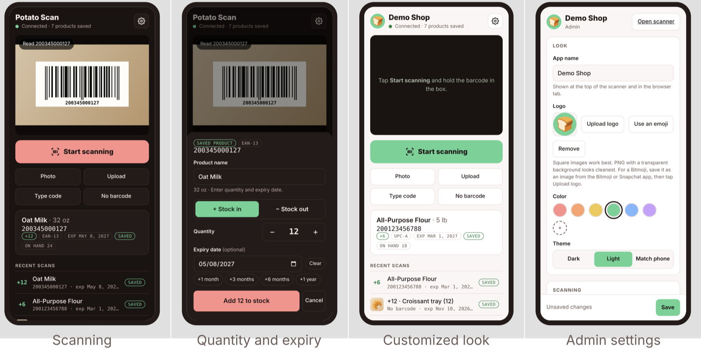

# Bakery Demand Forecasting and Inventory Analytics

**A simple weekly forecast, a phone-based stock scanner, a few replenishment rules and an online ordering site give a small bakery-café data-driven answers to "what do we bake, what do we buy, and when?"**

> **Project page:** open `index.html` (see *How to reproduce*). It becomes the GitHub Pages site once the repository is public.
>
> **Status: first draft, private.** Sections marked **[placeholder]** or *TODO* are still being written. Nothing in this repository is partner data: all figures are drawn from synthetic sample data or show aggregate results only, and results from the real data will be added only after our partner approves them.

<!-- Partner descriptor ("a small bakery cafe") is a placeholder until the partner approves wording in writing. -->

## In 60 seconds


Small food businesses rarely have a data team. Our partner, a small bakery cafe, decides every week how much of each item to bake and how many supplies to order. Today that decision is based on memory and on the same week last year, stock is counted on paper, and custom cake orders arrive through calls, texts and chat messages.

Over one semester our team built five connected pieces:

1. **A weekly demand forecast** for the cafe's best-selling items (Mohinuddin Shaikh).
2. **Inventory Capture**, a phone scanner that replaces paper stock counts (Abhishek Roushan).
3. **An inventory framework** that turns the forecast into shopping lists (Sun Xuan).
4. **A dashboard** that shows the owner sales trends and what to prepare (Sourabh Salunke).
5. **An online ordering website** with a two-factor admin portal, so custom cake orders arrive as structured data (Santiago Velasquez).

The forecast, each week, gives:

- **a number for each best-selling item** for the coming weeks,
- **a likely range** around that number, learned from how far past forecasts were off, and
- **a simple rating** (green, amber, red) that says whether to plan from the number, from the range, or with a fixed stock level.

The method is deliberately simple so the owner can understand and trust it: an average of recent weeks, split across items by their usual share. We tested it the way it would have been used, on more than 50 past weeks, each time using only the data available on that date.


## 1 · The problem and why it matters

*CAP domains I and II · Owner: **[placeholder: owner TBD]***

<!-- TODO (owner): rewrite in your own words, ~150–250 words. Draft taken from the paper. Intro figure from Task List #3 goes here. -->

Weekly production planning is hard for a small food business: stock is perishable, overproduction means wasted product on slow weeks, and underproduction means lost sales when popular items run out. Staffing does not follow real demand, ingredient purchasing followed informal minimums with no records, and the owner's own decorating time, not oven capacity, limited how many custom orders could be accepted.

**Research question:** can a forecast built from the business's own point-of-sale history give the owners practical, day-to-day guidance on production, inventory and staffing?

**Business needs we framed with the owner:**
- One place to track every order and its pickup date.
- A demand forecast for the cafe's main items.
- Structured, timestamped stock data for buying supplies on time.
- A clear picture of busy and slow periods for staffing.

We structured the work with a consulting-case approach (clarifying questions, structured problem framing, then recommendation, reasoning, risks and next steps) and a four-step system-design process (scope, high-level design, deep dive, wrap-up).

## 2 · The data

*CAP domain III · Owner: Sourabh Salunke (data cleaning)*

<!-- TODO (owner): review wording with the partner. Keep it general: no raw rows, column names copied from their systems, or exact dollar figures. -->

In collaboration with a small bakery cafe, we used point-of-sale records covering about a year and a half of daily item sales. Each record is one item sold, with a date, a product category, a quantity and an amount. We do not publish the data or describe it in more detail. A synthetic file with the same general structure is included in `data/synthetic/` so the code can be run end to end.

| Source | What it covers | Used for |
|---|---|---|
| Cafe point-of-sale export | About a year and a half of item-level sales | Weekly demand forecast, sales patterns |
| Recipe and ingredient file | Ingredient list and measured recipes for the custom cake flavors | Ingredient planning |
| Stock scans (new) | One row per scan from the Inventory Capture app (section 3) | Inventory framework, production plan |
| Website orders (new) | Structured custom cake orders from the site we built (section 4.4) | Future forecasting of custom orders |

**Data preparation.** Sales lines were aggregated into an item-by-week table and zero-filled for weeks with no sales. Every week is scaled to five trading days, short weeks are set aside, and one-off event weeks are left out (details in section 4.1).

Custom cake orders and stock counts were the main data gaps: one lived only in chat conversations, the other on paper. Sections 3 and 4.4 close those gaps going forward. The database schema behind the website links customers, orders, products and ingredients:


### 2.1 Data Foundation: Database and Inventory Layer

*Owner: Sourabh Salunke (database, data cleaning, inventory layer)*

**One shared database turns the partner's raw exports into inventory data a weekly planner can use.**



The partner supplied exports as CSV files. These were loaded into a Supabase (PostgreSQL) database and cleaned with SQL inside Supabase, so the whole team works from one consistent source instead of separate files.

On top of the sales tables we added an inventory layer: an **ingredients** table (group, shelf life, estimated cost, lead time, replenishment model, current stock) and a **recipes** table (in progress) linking each menu item to the ingredients it uses. Together they convert sales into expected ingredient usage, which is what the weekly planner needs.

Each ingredient follows one of three replenishment policies, chosen by how fast it spoils and how long it takes to arrive: periodic review for fresh dairy, reorder point for coffee beans and tea, and a visual two-bin rule for packaging.

**Next steps (data foundation)**
- Write the SQL cleaning query for the loaded sales data.
- Complete the recipes table (ingredient amount per menu item).
- Build the weekly planner model: forecast item sales, convert them to ingredient usage through the recipes table, and compare with current stock to produce a weekly order plan.
- Implement the replenishment policies as Python models and backtest them.
- Add a dashboard to the project site showing stock levels and the weekly plan.

*Limitation: ingredient costs are rough estimates until the partner supplies real figures. No partner data is stored in this repository.*

## 3 · Inventory Capture

*Owner: Abhishek Roushan (scanner and Inventory Capture section)*

**A phone scan replaces a paper count, so stock data arrives clean, timestamped and ready to plan production from.**


*Figure: staff scan a product, confirm quantity and an optional expiry date, and each scan is saved as one row for the dashboard, API and production plan.*

The scanner is a web app that turns any phone into a stock scanner. Staff scan, enter quantity and expiry, and the scan is saved, even offline.

- **One product, one number.** A retail barcode is a GS1 number (UPC-A in the US, EAN-13 elsewhere) whose last digit is a check digit, so a misread almost always fails the math. The same product can be reported as a 12-, 13- or 14-digit number, so the app turns every read into one standard form: one product is always one row, never three.

  
- **Failsafes.** Reading tries four engines in order: the phone's built-in reader, ZXing compiled to WebAssembly, ZXing in JavaScript, and Quagga2 for small or tilted codes. A number only counts once two camera frames agree, 8-digit codes are off by default to stop partial reads, and every scan carries a unique ID so a retry after a dropped connection is never counted twice. When a label won't scan, staff type the number or add the item with a photo.

  
- **Free product data.** Product names come from USDA FoodData Central (matched by UPC) and Open Food Facts, with the UPCitemdb free tier as a backup. Each product is looked up once and remembered, so with a free database plan and free hosting this replaces lookup services that start at about $99 a month.
- **Built for staff, set by the owner.** Big buttons, a beep on every read and one-tap expiry dates. An admin page lets the owner set the app name, logo, colour, theme, which features staff can use, and API keys for other apps.



*Screenshots use made-up demo data.*

**Disclosure.** We show the tool, never what it scanned. Code, setup and a demo with generated barcodes can be public; product lists, scan history, item photos, database keys and anything from the partner's shelves stay private.

<!-- TODO (Abhishek): the scanner code lives in src/barcode_reader/ and docs/inventory-capture.md on the branch docs/inventory-capture. Push that branch to this repository and open the pull request so it can be reviewed and merged. -->

## 4 · Approach and methodology

*CAP domains IV and V · Owners: section leads below*


### 4.1 The forecasting method

<!-- Section owner: Mohinuddin Shaikh -->

*Owner: Mohinuddin Shaikh (demand forecasting: method, evaluation, reproducibility)*

**Weekly, item-level sales forecasts with an honest margin of error, built for a small bakery cafe that plans production by hand.**

The forecast works in two steps. First, it predicts **total weekly units** for the whole cafe as the average of the last 12 normal weeks. Second, it **splits that total across items** using each item's average share of sales over the same 12 weeks. For forecasts further ahead, each new week's forecast is added to the history and the average is recalculated, so one rule covers any number of weeks.

We forecast the total first because single items are noisy. An item that sells five a week can easily sell three or eight by pure chance, while the total for the whole cafe is much steadier. Forecasting a total and dividing it is known as top-down forecasting (Hyndman & Athanasopoulos, 2021, ch. 11), and it has a useful side effect: the item forecasts always add up to the total.

Before forecasting, weeks are made comparable. Every week is scaled to five trading days, weeks with fewer than three trading days are set aside, and one-off event weeks are left out so they do not inflate the average for months afterwards.

Each forecast comes with a **likely range**: the 5th to 95th percentile of the model's own past errors (Williams & Goodman, 1971). We tested the method with a walk-forward evaluation (Tashman, 2000): from each past week, forecast up to 12 weeks ahead using only earlier data, then compare with what actually sold.


### 4.2 Inventory framework

*Owner: Sun Xuan (inventory, production planning)*

<!-- TODO (owner): rewrite in your own words and add your polished figure, ~150–250 words. -->

Ingredients are grouped by how fast they spoil and how much it hurts to run out, and each group gets the replenishment rule that fits its shelf life and lead time:

| Class | Examples | Rule |
|---|---|---|
| A · Perishables | Milk, dairy | **Periodic review** twice a week: order up to T = (P + L) × d + S, rounded to whole units |
| B · Core supplies | Coffee beans, tea | **Reorder point**: ROP = d × L + SS, triggered by the count of unopened bags |
| C · Packaging and drinks | Cups, lids, canned drinks | **Two-bin / red line**: a visual trigger, no data entry |

*d = average daily demand, P = review period, L = lead time, S and SS = safety stock, T = order-up-to level.*

The weekly forecast feeds a bill-of-materials conversion (for example, ounces of beans per coffee drink), which produces a supermarket run list and an online order sheet. Stock counts come from the Inventory Capture scanner (section 3), so the digital inventory stays aligned with what is really on the shelf.

### 4.3 Dashboard

*Owner: Sourabh Salunke (dashboard, reporting)*

**Planned.** A dashboard on the project site will show current stock levels and the weekly order plan, built on the database and inventory layer described in section 2.1. <!-- TODO (owner): add a screenshot with synthetic or approved data once it is built. -->

### 4.4 Online ordering website

*Owner: Santiago Velasquez (website front end and back end, online ordering)*


*Figure: how an order moves through the system. Top row: what the customer does. Middle: the database checks and stores it. Bottom: what the owner does.*

Custom cake orders were the one part of the business with no data at all: they arrived by calls, texts and chat messages, details got lost, and prices were worked out by hand each time. I built a website, front end and back end, that replaces those threads with one guided ordering process.

1. **Choose a cake** in one of three ways: a ready-made cake from the shop, a cake designed in a seven-step builder (size, flavor, filling, icing, color, message, review), or a quote request for anything unusual.
2. **See the price at every step.** The builder draws the cake as it is designed and updates the total with each choice.
3. **Pick a pickup date.** The calendar greys out days that are too soon (cakes need a week's notice) and stripes the days the owner has blocked.
4. **Send the order.** Before saving, a database function checks it again: current prices, item still offered, enough notice and date still open, so a price changed in the browser is never accepted.
5. **The owner answers** from a private portal protected by a password and an authenticator app: orders on a calendar, accept or decline, block days off. The customer is emailed automatically.

Every order is stored with the fields in the schema in section 2, which gives the forecast its first structured source of custom-order data and lets recipes turn confirmed orders into ingredient lists for the inventory framework.

| Part | Technology | What it does |
|---|---|---|
| Front end | HTML, CSS and plain JavaScript | Pages customers use, on phones and computers, no app to install |
| Database | Supabase (PostgreSQL) | Stores products, orders, quotes and blocked days |
| Order checks | Database functions (RPC) | Re-check prices, notice and dates before an order is saved |
| Security | Row-level security, two-factor login | Customers can only send orders, never read them; only the owner can |
| Emails | Edge function | Sends the confirmation or decline when the owner answers |

**Screenshots** (demo version: placeholder bakery name, drawn cakes, sample prices):

| | |
|---|---|
|  **Home.** Leads to the three ways to order. |  **Shop.** Ready-made cakes with starting prices. |
|  **Builder.** Seven steps; the drawing and price update with each choice. |  **Cart and calendar.** Grey = too soon, striped = blocked by the owner. |
|  **Order received.** Order number right away; nothing charged until the owner accepts. |  **Quote request.** For designs the builder can't cover. |

The admin portal isn't pictured because it needs a real login and shows real customer orders.

## 5 · Results and recommendations

*CAP domains V and VI · Owner: **[placeholder: owner TBD]***

**[placeholder: pending partner approval]** Aggregate accuracy of the method against simple rules ("same as last week", "same week last year"), how often the likely range contained the actual result, and what this means for weekly planning.

<!-- TODO (team): the draft below comes from the project paper (14 rolling origins, 4-week horizon). Align it with the walk-forward evaluation in section 4.1 and confirm the numbers can be shown before the repository goes public. -->


- **Simple beat complex.** Every model that tried to predict movement lost to the one that estimated the level carefully. XGBoost scored 45.7% WAPE (total units missed divided by total units sold), which we attribute to having only about 1,260 training rows for 18 series.
- **About 10 points better than the owner's natural baseline** (47.2% for carrying last week forward) and 20 points better than "same week last year". High-volume items forecast better, at roughly 20–30% error.
- **The day of the week is the biggest unused signal.** Wednesday sells about five times as many units as Saturday, so a daily model is the next test.
- **The ordering site and the scanner work as prototypes** and now record custom orders and stock counts as structured data.

### Recommendations for the owners

- Stock up for midweek: Wednesday is the strongest day, and the weekend is the weakest stretch.
- Build up inventory and staffing ahead of September, the peak month.
- Plan downtime or smaller orders for late December to early January, the slowest period.
- Use the twice-weekly dairy review and reorder points instead of buying on habit, with counts from the scanner.

## 6 · Limitations and next steps

*CAP domains VI and VII · Owner: **[placeholder: owner TBD]***

For the forecast: sales records show what sold, not what customers wanted when an item ran out; seasonality cannot be estimated reliably until at least two full years of data exist; known events (holidays, local events, large pre-orders) should be entered as adjustments. Custom-order history exists only from the website onward. Deployment and maintenance plan to follow.

- **Daily model** with day-of-week features.
- **Validate the inventory framework** against actual purchases and waste.
- **Synthetic scan log** so the scanner pipeline runs end to end, then feed scans into the dashboard.
- **Recipe-based ingredient planning** for confirmed custom cake orders, using the website's order data.
- **Online deposit payments** and a demo mode for the admin portal.

## How to reproduce

### Forecast (Python, under a minute)

<!-- Section owner: Mohinuddin Shaikh -->

Requires Python 3.10 or newer. Everything below runs on the synthetic sample data in under a minute.

```bash
git clone <repository-url>
cd bakery-demand-forecasting
python3 -m venv .venv
source .venv/bin/activate            # Windows: .venv\Scripts\activate
pip install -r requirements.txt
nbstripout --install                 # clears notebook outputs automatically on commit

python src/make_synthetic_data.py    # 1. create data/synthetic/sample_sales.csv
python src/run_forecast.py           # 2. walk-forward test + next 4 weeks of forecasts
python src/plot_figures.py           # 3. redraw the figures in reports/figures/
```

`run_forecast.py` prints the error of the model and of two simple benchmarks, and how often actual sales fell inside the likely range. It writes `accuracy.csv`, `coverage.csv` and `forecast.csv` to `reports/output/` (not committed).

To run on real data, copy `config/settings.example.json` to `data/settings.json` and point it at your files. Everything in `data/` except `data/README.md` and `data/synthetic/` is git-ignored, so real data and its settings stay on your machine.

**[placeholder]** Notebooks for exploratory analysis and model comparison will be added to `notebooks/` with outputs cleared.

### Project page and ordering website (about 2 minutes)

```bash
python3 -m http.server 8080   # from the repository folder; or, with Node.js installed: npm start
```

Open http://localhost:8080 for the project page (`index.html`, the web version of this README). The ordering demo is at http://localhost:8080/src/web/. With the placeholder values in `src/web/js/config.js`, the site runs in **demo mode**: the catalog comes from `src/web/js/data.js`, the calendar blocks Mondays plus a few sample days, and orders are saved in your browser (open the console and run `DemoBackend.requests()` to see them).

To connect a real backend:

1. Create a free project at [supabase.com](https://supabase.com) and install the CLI (`npm install`).
2. Apply the schema in order: `npx supabase link --project-ref <ref>` then `npm run db:push`.
3. Put your project URL and publishable key in `src/web/js/config.js`.
4. Create the owner account in Supabase Auth, then add its user id to `public.admins` in the SQL editor. The portal asks the owner to set up an authenticator app on first login.
5. Optional email: set the secrets listed in `.env.example`, then `npm run fn:deploy`.
6. The "too soon" check uses the bakery's local time zone, set to `America/New_York` in `0001_init.sql` and `0003_catalog.sql`. Change it to yours.
7. Rename `src/web/admin.html` to a hard-to-guess file name before deploying.

### Inventory Capture scanner

Open `src/barcode_reader/index.html` and press **Sample**. No install, account or data needed. Live camera, database and admin page are placeholders until the partner approves. *(Code arrives with Abhishek's pull request.)*

## Repository structure

```
bakery-demand-forecasting/
├── README.md
├── index.html                   project page: this README as a web page (future GitHub Pages site)
├── requirements.txt             Python packages for the forecast
├── package.json, .env.example   ordering website tooling
├── config/
│   └── settings.example.json    settings for the synthetic data (copy to data/settings.json for real data)
├── data/                        git-ignored except README.md and synthetic/
│   ├── README.md
│   └── synthetic/sample_sales.csv
├── docs/figures/                project-wide figures and website screenshots
├── notebooks/                   [placeholder] analysis notebooks, outputs cleared
├── reports/
│   └── figures/                 forecast figures
├── supabase/                    website database schema, row-level security, order checks, email function
└── src/
    ├── forecasting/             the forecasting package
    │   ├── config.py            settings and defaults
    │   ├── data_prep.py         cleaning, weekly calendar, item-by-week table
    │   ├── model.py             top-down recursive forecast
    │   └── evaluation.py        walk-forward test and likely ranges
    ├── make_synthetic_data.py   generates the sample dataset
    ├── run_forecast.py          runs the test and the forecast
    ├── plot_figures.py          draws the README figures
    ├── web/                     ordering website and admin portal (HTML, CSS, JavaScript; no build step)
    │   └── js/demo-backend.js   local stand-in for the database, used in demo mode
    └── barcode_reader/          [pending pull request] Inventory Capture scanner
```

## Tools

Python (pandas, NumPy, SciPy, statsmodels, matplotlib), Git and GitHub. Website: HTML, CSS, JavaScript and Supabase (PostgreSQL, row-level security, edge functions). Scanner: browser barcode reader, ZXing, Quagga2, Open Food Facts and USDA FoodData Central.

## Team

| Name | Role | LinkedIn (optional) |
|---|---|---|
| Mohinuddin Shaikh | Demand forecasting: method, evaluation, reproducibility | |
| Abhishek Roushan | Inventory Capture: barcode scanner app | |
| Sun Xuan | Inventory and production planning | |
| Sourabh Salunke | Database, data cleaning, inventory layer, dashboard | |
| Santiago Velasquez | Ordering website: front end, back end and admin portal | |
| Prateek Jaiswal | Faculty mentor | |

## Literature that shaped the project

- Safieddine & Nakhoul (2021): messaging-app ordering in small firms; the same problem we saw.
- Cardoso, Leitão & Geraldes (2024): ABC classification and review policies in a bakery.
- Franco et al. (2026): lightweight forecasting for micro and small enterprises.
- Douaioui et al. (2024): review of 119 machine-learning demand forecasting studies.
- Piewthongngam, Homkhampad & Apichottanakul (2026): from sales forecasts to ingredient replenishment.
- Motamedi, Li & Down (2026): forecast-dependent ordering of perishable products.
- Xu (2020), *System Design Interview*; Cosentino (2024), *Case in Point*.

## Acknowledgments

This project was completed as part of an industry practicum at Purdue University in collaboration with a small bakery cafe. **[placeholder: wording to be approved by the partner]**

**AI use:** AI coding assistants helped write parts of the website and scanner code and this README draft. Every change was reviewed and tested by the team. No partner data or names were shared with AI tools, identifying details were removed before anything was committed, and the repository contains only synthetic data and aggregate results.

## References

- Hyndman, R. J., & Athanasopoulos, G. (2021). *Forecasting: Principles and Practice* (3rd ed.). OTexts. https://otexts.com/fpp3/
- Tashman, L. J. (2000). Out-of-sample tests of forecasting accuracy: an analysis and review. *International Journal of Forecasting*, 16(4), 437-450.
- Williams, W. H., & Goodman, M. L. (1971). A simple method for the construction of empirical confidence limits for economic forecasts. *Journal of the American Statistical Association*, 66(336), 752-754.
